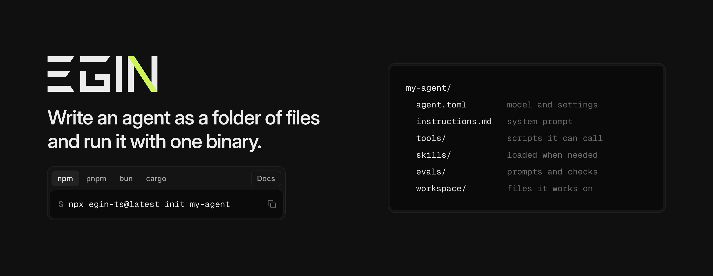
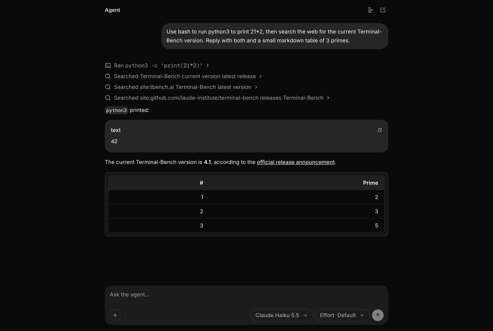

# egin



A filesystem-first framework for durable backend agents. An agent is a folder; one Rust binary runs, serves, evaluates and benchmarks it. Models, web search and sandboxes are each pluggable: the You.com Inference Router (default), OpenAI, Vercel AI Gateway, Gemini, Claude on the Claude API, every Amazon Bedrock model, or any OpenAI-compatible endpoint; You.com, Parallel, Firecrawl, context.dev, Brave or SearXNG for search; and a microVM per session (microsandbox), E2B, Vercel Sandbox, Daytona, Docker Sandboxes or the host for tools.

*egin* is Basque for "to do, to make".

Docs: [egin.dev/docs](https://egin.dev/docs). Benchmark results: [egin.dev/docs/results](https://egin.dev/docs/results).

## Quick start

```bash
export YDC_API_KEY=...            # or put it in .env.local
cargo build --release
./target/release/egin init my-agent --template research   # basic, research, ops, support or web
./target/release/egin run my-agent "Who maintains SQLite, and under what license?"
```

| Command | What it does |
|---|---|
| `egin init <dir> [--template t]` | Write a starter agent folder |
| `egin add [item]` | Add a connection, channel, trace exporter or tool from the built-in catalog; with no item, list it |
| `egin connect <name>` | Sign in to an MCP connection with `auth = "oauth"` in the browser; tokens go to `.egin/oauth/` |
| `egin docs [page]` | Print the documentation, from the binary |
| `egin info <dir>` | Resolved config, tools, skills, subagents, schedules, MCP connections, channels |
| `egin models` | Router models with context limits and prices |
| `egin run <dir> "<prompt>"` | Run one prompt. `--yes` approves tools, `--session <id>` resumes, `--set key=value` overrides config |
| `egin chat <dir>` | Interactive session |
| `egin serve <dir> --port 8787` | HTTP API, event stream, channels and schedules; `--host` needs `EGIN_TOKEN` beyond loopback |
| `egin eval <dir>` | Run `evals/` under every variant; `--model`, `--variant`, `--split`, `--task`, `--jobs` |
| `egin bench <tasks> --agent <dir>` | Terminal-Bench 2 (or converted SWE-bench) tasks in microVMs, one arm per variant |
| `egin evolve <dir> --model m` | Edit a model's profile from eval traces, keeping only edits that score better |
| `egin report <results>...` | One HTML page from results folders |

## Agent folder

```
my-agent/
  agent.toml               model and switches
  instructions.md          system prompt
  memory/*.md              appended to the system prompt; the `memory` tool edits memory/notes.md
  skills/<name>/SKILL.md   listed in the prompt, loaded on demand with the `skill` tool
  tools/<name>.py          one script per tool, any language; `# description:` and `# param` comments at the top, JSON arguments on stdin, result on stdout
  middleware/pre_tool      runs on the host with {"tool","args"} on stdin; a non-zero exit blocks the call
  hooks/<event>            runs on the host for each stored event; what hooks/done prints sends the run on
  connections/<name>.toml  MCP servers: `command = [...]` (stdio) or `url = "..."` (HTTP), `safe = [...]`
  channels/<name>.toml     a signed webhook, Slack, Telegram, Discord, GitHub, Vercel Board, or an MCP server at /mcp
  instrumentation/<name>.toml  an OTLP endpoint and headers that traces go to
  subagents/<name>/        a nested agent folder, called with the `task` tool
  schedules/<name>.toml    `cron = "0 9 * * *"` or `every_secs`, plus `prompt`; run by `egin serve`
  profiles/<model>.toml    per-model switch defaults; profiles/<model>.md adds per-model instructions
  evals/<name>.toml        prompt + check (shell, run in the sandbox) and/or expect (substring)
  evals/<name>/task.toml   the same, with evals/<name>/files/ copied into the workspace first
  evals/variants.toml      named sets of config overrides; `external = "<driver>"` runs another harness instead
  workspace/               mounted at /workspace in the VM
  .egin/                   sessions (egin.db), file index, tool output
```

Precedence: built-in defaults < `profiles/<model>.toml` < `agent.toml` < `--set`. `profile = false` ignores the profile.

## Switches (agent.toml)

| Key | Default | Meaning |
|---|---|---|
| `model` | `kimi-k3.1-pro` | Any id the provider serves |
| `provider` | from the model id | `openai` (chat completions), `anthropic` (Messages API) or `bedrock` (Claude in Amazon Bedrock). Unset: `claude-*` is `anthropic`, `anthropic.claude-*` is `bedrock`, anything else `openai` |
| `base_url`, `api_key_env` | the provider's | Another endpoint, or the env var holding its key (defaults: `YDC_API_KEY`, `OPENAI_API_KEY`, `AI_GATEWAY_API_KEY` or `VERCEL_OIDC_TOKEN`, `GEMINI_API_KEY`, `ANTHROPIC_API_KEY`, `AWS_BEDROCK_API_KEY` with `AWS_REGION`) |
| `vision` | from the provider | Whether the model sees images; read_file sends images only when it does |
| `audio_model` | the session's model if it hears, else the cheapest that does | Transcribes audio files for read_file |
| `tool_style` | `typed` | `bash` leaves only the bash tool |
| `web` | `client` | `server` lets the model provider run search and page fetches (the router's tools, or Claude's web search and web fetch on the Claude API); `off` |
| `search` | `you` | Provider behind the client web tools: `you`, `parallel`, `firecrawl`, `context.dev`, `brave` (keys `PARALLEL_API_KEY`, `FIRECRAWL_API_KEY`, `CONTEXT_DEV_API_KEY`, `BRAVE_API_KEY`) or `searxng` (`SEARXNG_URL`). The first four fetch pages through their own extraction; Brave and SearXNG fetch directly, HTML and PDFs to text |
| `search_mode`, `search_count`, `freshness`, `include_domains`, `exclude_domains` | `highlights`, 5 | You.com Search options; `exclude_domains` also blocks fetches and filters results the API lets through |
| `exclude_terms` | `[]` | Withhold search results and fetched pages containing any of these strings (case-sensitive), for evals whose answers are republished |
| `exclude_echo` | `false` | Withhold search results and fetched pages that repeat twelve or more words of the task in a row (outside its own quotation marks): a page that reproduces a benchmark question usually prints its answer |
| `batching` | `true` | Several tool calls per turn; safe ones run concurrently |
| `planning` | `false` | Adds the `plan` tool |
| `compaction`, `tool_output_max` | `true`, 50000 | Truncate long tool output on entry (head and tail kept); the full text is saved to `.egin/out/` in the sandbox |
| `page_max` | 30000 | Characters of a page, document or search result shown at once. read_file and web_fetch give longer ones a part at a time, with the offset to continue; web_search trims each hit to an equal share |
| `elision`, `elide_at`, `keep_recent` | `true`, 0.5, 6 | Stub out old tool output once the context passes that share of the limit |
| `summarisation`, `summarise_at` | `true`, 0.75 | Summarise old turns past that share |
| `memory_max` | 0 (off) | Adds the `memory` tool, capped at this many bytes |
| `index` | `false` | Adds `search_files`: full-text and metadata search over the workspace (SQLite FTS5) |
| `approval` | `ask` | `never` runs bash and file writes without asking |
| `max_turns`, `max_cost` | 60, 0 (off) | Per-session limits |
| `sandbox` | `auto` | `auto`: microsandbox where the host supports it (KVM, Apple Silicon, WHP), else `local` with a warning. `e2b`: E2B sandboxes (`E2B_API_KEY`, template `E2B_TEMPLATE`, default `base`). `vercel`: Vercel Sandbox (`VERCEL_TOKEN` with `VERCEL_TEAM_ID` and `VERCEL_PROJECT_ID`, or `VERCEL_OIDC_TOKEN`). `daytona`: Daytona cloud sandboxes (`DAYTONA_API_KEY`). E2B and Vercel cannot limit egress to a host list, so they take `network = ["*"]` (or `[]` on E2B). `docker` / `docker-cloud`: Docker Sandboxes, local microVM or Docker's cloud, through the signed-in `sbx` CLI. Cloud backends copy the workspace up once and don't sync it back; `secrets` need microsandbox |
| `image`, `cpus`, `memory_mb`, `idle_timeout`, `workdir` | `python:3.13-slim`, 2, 2048, 600 | The session VM |
| `network` | `["*"]` | VM egress: `["*"]` all, `[]` none, or domains (`".example.com"` for subdomains) |
| `secrets` | `[]` | `[{ name = "API_KEY", host = "api.example.com" }]`: the VM sees a placeholder; the real host env value is substituted only on requests to that host |
| `context_limit` | from `/v1/models` | Override the model's context window |

## Documents and images

`read_file` returns text files as they are, PDFs, Word, PowerPoint and spreadsheets (xlsx, xls, ods) as text, converted on the host (`src/tools/docs.rs`), audio as a transcript from a model that hears (`audio_model`), and images as images when the model can see them: the image follows the tool results as a user message for chat-completions models, and goes inside its `tool_result` on the Messages API. Files a user uploads through `egin serve` land in `workspace/uploads/<session>/`; attached images are sent to vision models directly. Claude replies are stored with their raw content blocks (`anthropic_content`) and echoed back unchanged, so signed thinking and server-tool results stay valid; `src/model/claude.rs` converts the rest.

## Sandboxing

Each session gets its own microVM (`egin-<session>`), created on the first tool call. The agent's workspace is bind-mounted at `/workspace` and its `tools/` folder read-only at `/egin/tools`. The VM stops after `idle_timeout` seconds and restarts on the next call. After a crash it is reconnected, or replaced if its creation was cut off. It is removed when the session is deleted or an eval run ends. With `sandbox = "local"`, commands run on the host as a process group that is killed whole on timeout. microsandbox is pinned (`=0.7.15`); after bumping it, run `cargo test --test sandbox`.

## HTTP API

| Route | Body | Result |
|---|---|---|
| `POST /sessions` | `{"message"?}` | `{"id"}`; starts a run when a message is given |
| `POST /sessions/{id}/messages` | `{"message", "files"?}` | Continue a session; `files` are uploads from the route below |
| `POST /sessions/{id}/files?name=<name>` | The raw file | `{"name", "path", "size"}`; saved under `workspace/uploads/<session>/`, up to 25 MB |
| `GET /sessions?limit=50` | | `{"sessions": [{"id", "status", "created", "title"}]}`, newest first; with `X-Egin-User`, only that user's |
| `GET /sessions/{id}` | | Status, stats, messages |
| `DELETE /sessions/{id}` | | Stop it, remove its VM, delete its records |
| `GET /sessions/{id}/events?after=<event id>` | | SSE: stored log replayed, then live events (`token`, `assistant`, `tool_call`, `tool_result`, `approval_request`, `done`, ...) |
| `POST /sessions/{id}/approvals` | `{"call_id", "allow"}` | Answer an `approval_request`; the answer is stored and survives a restart |
| `POST /sessions/{id}/cancel` | | Stop a running session |
| `POST /channels/webhook` | `{"text", "thread"?}` | HMAC-SHA256 signed (`X-Egin-Signature: sha256=<hex>`); one session per thread |
| `POST /channels/slack` | Slack Events API | Signature and replay checked; replies in the thread |

With `EGIN_TOKEN` set, the session routes need `Authorization: Bearer <token>`; the channel routes keep their own signature checks. `egin serve` binds `127.0.0.1` by default and refuses any other `--host` without a token. For many users behind one app, the app's server sends `X-Egin-User: <id>` after its own sign-in: sessions it creates belong to that user, and every `/sessions/{id}` route answers 404 for someone else's. Requests without the header are the operator's. An approval must name a call of the session in its URL.

## Frontends

The `egin-ts` npm package contains the CLI (a launcher plus the prebuilt binary for each platform, in `npm/`), `egin-ts/client` (sessions, uploads, approvals, session lists, and an event stream that reconnects from the last event id), `egin-ts/react` and `egin-ts/vue` (`useAgent`) and `egin-ts/svelte` (`createAgent`, a store), all over one framework-free `Agent` class. `egin-ts/proxy` forwards a web app's calls to `egin serve`, adding the token so it never reaches the browser, and `egin-ts/next` wires it into Next.js: `withEgin` in `next.config.ts` starts the server for `next dev` and `next start`, and one route file forwards `/egin/*`. `egin init my-chat --template web` writes such an app, with the agent in `agent/` and a shadcn chat that picks the model and reasoning effort per session:



`npm/egin` has its own tests (`npm test`); `npm/release.sh` builds every platform package and, with `--publish`, publishes them.

## Durability

Sessions live in `<agent>/.egin/egin.db` (SQLite). The loop is driven only by the stored messages, so a killed run resumes from the last stored message and completed model calls are never repeated. `egin serve` resumes interrupted sessions on start. A side-effecting tool call that was running when the process died is not re-run blindly: the model is told its effects are unknown and checks the state first. Several processes may share one agent folder: a writer waits up to 60 seconds for the database lock.

## Observability

`EGIN_LOG=json` writes every stored event to stderr as one JSON line. With `OTEL_EXPORTER_OTLP_ENDPOINT` (or `OTEL_EXPORTER_OTLP_TRACES_ENDPOINT`) set, sessions, model calls and tool calls are exported as OTLP/HTTP spans, one trace per session.

## Benchmarks

```bash
git clone https://github.com/laude-institute/terminal-bench-2 ../tb2
egin bench ../tb2 --agent bench/tb2 --subset bench/tb2/subset.txt --model deepseek-v4.1-flash
egin report bench/tb2/results/<run> --title "Terminal-Bench 2 subset" -o results.html
```

The Terminal-Bench images are amd64-only, so `egin bench` rebuilds each task as an arm64 microVM from its Dockerfile, forks it per arm, and grades with the task's own `tests/test.sh`. Numbers compare arms on identical environments; they are not comparable to the official leaderboard. `--oracle` runs the reference solutions to validate the rebuilt environments.

`bench/swebench/prepare.py` converts SWE-bench Verified instances into the same task format (arm64 setup scripts from swebench 3, graded by swebench's log parsers), sealed so the upstream fix is unreachable: base-commit history only, GitHub/PyPI/djangoproject blocked, grader offline. `bench/eve-arm` runs eve's default harness as an arm on the same VMs, metered by a proxy in front of the router that also serves egin's web tools, so both harnesses search alike.

Epoch AI rates both Terminal-Bench and SWE-bench Verified as flawed (scoring defects; SWE-bench is also contaminated), so treat their numbers as arm-vs-arm comparisons only.

Two suites Epoch rates as verified run through `egin eval`:

```bash
python3 bench/simpleqa/prepare.py out/simpleqa --n 100
egin eval out/simpleqa --model deepseek-v4.1-flash --jobs 8
uv run --with pandas --with pyarrow python bench/graphwalks/prepare.py out/graphwalks --mode file
egin eval out/graphwalks --model deepseek-v4.1-flash --jobs 4
```

- SimpleQA Verified: short factual questions, graded by a judge model pinned in each task (`judge = { answer, model }`; only CORRECT passes). The arms are web via egin's client tools, web via the router, and closed-book (no web, no VM network).
- GraphWalks (128K and shorter): BFS and parent queries, graded by exact match of the `Final Answer: [...]` set (`answer_set`). `--mode inline` is the canonical prompt and mostly measures the model. `--mode file` moves the graph into `graph.txt`, so the agent reaches it through tools; it measures the harness and is not comparable to published scores.

## Code layout

| Path | What lives there |
|---|---|
| `src/main.rs`, `src/cli.rs` | Entry point and the `egin` subcommands |
| `src/app.rs`, `src/telemetry.rs`, `src/store.rs` | Shared state and event bus, OTLP spans, SQLite sessions and events |
| `src/agent/` | Loading the agent folder (config precedence, profiles), the loop (`run`), `hooks`, structured `output` |
| `src/model/` | The router client: chat completions, Responses, Claude Messages, providers |
| `src/tools/` | Built-in tools, `web` search and fetch, `mcp` clients and their `oauth`, `docs` text for `read_file`, the FTS `index` |
| `src/server/` | HTTP/SSE API, `channels` (webhook, Slack), the agent as an `mcp` server |
| `src/sandbox/` | `microvm`, `e2b`, `vercel`, `daytona`, `docker` backends behind one `exec` |
| `src/eval/` | Eval runner, `bench` (Terminal-Bench, SWE-bench, external harnesses), `evolve`, `report` |
| `src/catalog.rs`, `src/atif.rs` | `egin add` integrations, sessions as ATIF trajectories |

## Tests

```bash
cargo test
cargo clippy --all-targets -- -D warnings
cargo fmt --check
```

`tests/common/` holds a scripted mock of the router, search and contents APIs that speaks the real SSE wire format, so the production client is what runs. The suites are split by area: `agent_loop.rs`, `tools.rs`, `channels.rs` (HTTP API, webhook, Slack), `eval.rs` and `rate_limit.rs`. `tests/sandbox.rs` boots real microVMs (skipped without virtualization) and runs the Daytona and Docker Sandboxes backends when their credentials are present.

Environment: `YDC_API_KEY`, `EGIN_BASE_URL` (default `https://api.you.com/v1`; any OpenAI-compatible endpoint works), `EGIN_SEARCH_URL` (default `https://ydc-index.io/v1`), `EGIN_TOKEN` (bearer token for `egin serve`), `EGIN_LOG`, plus the key of each provider an agent uses (see Switches). Keys are checked when a provider is first called, not at startup.

## License

MIT. See [LICENSE](LICENSE).
